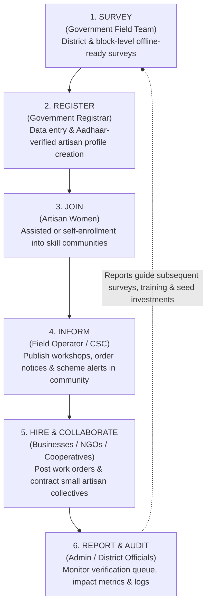

# Trino — NariSetu (নারী সেতু / नारी सेतु)

> **Rural Women Financial Empowerment by Utilizing their Skills into Business Needs & Micro-Enterprises**  
> A centralised, government-monitored, community-powered digital bridge connecting rural craftswomen with market opportunities, training programs, and sustainable livelihood networks.

---

[](./LICENSE)
[](https://nodejs.org/)
[](https://fastify.dev/)
[](https://react.dev/)
[](https://tailwindcss.com/)
[](https://www.prisma.io/)
[-00e599.svg)](https://neon.tech/)

---

## 📌 Table of Contents

1. [Prototype Overview & Core Idea](#-prototype-overview--core-idea)
2. [Problem Statement & Background](#-problem-statement--background)
3. [The 3 Core Pillars & Approach](#-the-3-core-pillars--approach)
4. [End-to-End Working Flow (6-Step Lifecycle)](#-end-to-end-working-flow-6-step-lifecycle)
5. [Team Roles & Contributions](#-team-roles--contributions)
6. [Key Platform Features](#-key-platform-features)
7. [Technology Stack](#-technology-stack)
8. [Project Structure & Requirement Files](#-project-structure--requirement-files)
9. [Setup, Initialization & How to Run](#-setup-initialization--how-to-run)
11. [API Endpoints Reference](#-api-endpoints-reference)
12. [Impact on Rural Development](#-impact-on-rural-development)
13. [License](#-license)

---

## 💡 Prototype Overview & Core Idea

In urban centers and towns, women have access to numerous digital and commercial channels to showcase their skills, access gigs, and generate independent household income. In rural villages, women possess rich, time-honored, practical proficiencies—such as **handloom weaving, kantha/zari embroidery, tailoring, pottery/terracotta, bamboo and jute handicrafts, food processing (pickles, papad, spices), and agri-allied work**—yet they face profound barriers to market access, financial literacy, and institutional support.

**NariSetu** (developed under project **Trino**) is a centralized, government-monitored web platform that bridges this divide. It serves as an integrated ecosystem connecting rural craftswomen, grassroots field survey teams, Community Service Centre (CSC) operators, NGOs, private enterprises, and government district administrations. 

Instead of treating rural women as isolated, unorganized labor, NariSetu:
- **Identifies and registers** verified artisan profiles block by block.
- **Clusters women into skill communities** managed by trained local operators.
- **Enables complementary skill grouping** (e.g., pairing a stitching artisan with an embroidery specialist to fulfill bulk garment orders).
- **Channels corporate and institutional demand** directly to grassroots collectives without exploitative middlemen.
- **Provides data-driven visibility** for government departments to target subsidies, seed capital, and training schemes based on real verified capacity.

---

## ❗ Problem Statement & Background

### 1. Problem Statement
> *Rural women’s skills and local resources often remain fragmented, undocumented, and disconnected from complementary talent, viable market opportunities, and the institutional support needed to develop sustainable livelihood initiatives.*

### 2. Core Problem
> *The absence of an accessible, integrated mechanism to identify complementary skills, connect potential collaborators, and assess local livelihood opportunities makes it difficult for rural women to translate their existing capabilities into collective economic activities.*

### 3. The Digital Divide Challenge
Field studies (including GSMA Mobile Gender Gap benchmarks) indicate an acute **45% gender gap in mobile internet usage in rural India** (26% rural women vs 47% rural men, compared to 42% urban women vs 62% urban men). 

Because rural women frequently lack personal smartphones or digital literacy, a purely consumer-facing app fails. **NariSetu overcomes this barrier through an assisted intermediary architecture**: trained block-level **Operators** and **Government Enumerators** act as digital custodians, entering survey data, moderating community boards, and bridging the digital divide on behalf of the beneficiaries.

```
Mobile Internet Adoption Disparity:
  Urban Men   : [████████████████████████████████] 62%
  Urban Women : [██████████████████████] 42%
  Rural Men   : [████████████████████████] 47%
  Rural Women : [█████████████] 26%  <--- NariSetu targets this 45% rural divide!
```

---

## 🏛️ The 3 Core Pillars & Approach

NariSetu is built upon three foundational operational principles:

1. **Government-Led**:
   - Direct involvement of administrative bodies in block-wise surveying, identity verification (Aadhaar reference linkage), and governance.
   - Injects institutional trust, credibility, and national scale, eliminating fraudulent middlemen.
2. **Community-Based**:
   - Rural artisans do not work in isolation. Grouping women into skill-specific peer communities fosters peer learning, mutual support, and collaborative enterprise formation.
3. **Data-Driven**:
   - Real-time audit trails, enrollment metrics, and regional trade statistics eliminate administrative guesswork.
   - Public funds, skill upgrade workshops, and micro-credit links are deployed where verifiable demand and capability exist.

---

## 🔄 End-to-End Working Flow (6-Step Lifecycle)

The NariSetu operational lifecycle follows a continuous, closed-loop six-step process:



### Detailed Breakdown of Steps:

| Step | Responsible Actor | Action & System Workflow |
| :--- | :--- | :--- |
| **1. Survey** | Government Field Survey Team | Visits village blocks, conducts door-to-door or SHG cluster surveys, records primary crafts, production capacity, demographic details, and verified consent. |
| **2. Register** | Government Registrar / Portal | Inputs field records into the centralized system, validates Aadhaar reference integrity, issues a unique beneficiary identifier (e.g. `ART-WB-ND-8492`), and stores geo-tagged block data. |
| **3. Join** | Selected Woman / Beneficiary | The verified beneficiary is enrolled into targeted craft guilds (e.g., *Tailoring & Embroidery*, *Handloom & Weaving*, *Food Processing*, *Handicrafts*). |
| **4. Inform** | Community Operator (CSC) | Operator manages the community hub, translates complex scheme notices, announces government training camps, and posts inbound bulk order inquiries. |
| **5. Hire** | Businesses, NGOs & Cooperatives | Verified organizations review artisan registers, post supply contracts (e.g., 500 school uniform sets, hand-knitted jute bags), and hire complementary artisan teams. |
| **6. Report** | District & State Admin | System logs all transactions, tracks wage disbursement, evaluates block performance, and generates policy dashboards for subsequent funding rounds. |

---

## 👥 System Roles & Responsibilities

The system defines 6 specialized stakeholders interacting through role-tailored dashboards and permissions:

| System Role | Key Responsibilities & Capabilities |
| :--- | :--- |
| **Government Survey Team** | • Conducts block and Gram Panchayat-level artisan censuses.<br/>• Collects craft proficiencies, production limits, and socio-economic data.<br/>• Uses offline-ready survey forms in remote rural blocks. |
| **Government Registrar** | • Verifies identity documentation, Aadhaar formatting, and demographic data.<br/>• Issues official digital artisan certificates and UID registries.<br/>• Audits records to prevent duplication of government benefits. |
| **Selected Woman (Artisan)** | • Accesses localized craft communities in regional languages (Bengali, Hindi, English).<br/>• Explores government schemes (e.g., Lakhpati Didi, PM Vishwakarma).<br/>• Collaborates with fellow artisans possessing complementary skills.<br/>• Applies for local work needs, exhibitions, and training grants. |
| **Community Operator (CSC)** | • Moderates local skill group discussions and answers member queries.<br/>• Creates and schedules skill upgrade events and training workshops.<br/>• Assists low-literacy women with application filings and status checks.<br/>• Syncs offline field survey records into the cloud backend. |
| **Business / NGO / Organization** | • Submits corporate verification documents for government clearance.<br/>• Posts work opportunities, tenders, raw material support, and bulk orders.<br/>• Discovers local verified talent by craft, block, and capacity.<br/>• Directly hires or partners with self-help groups (SHGs). |
| **Platform Administrator** | • Reviews and approves partner NGO/Business verification queues.<br/>• Manages operator credentials and access permissions.<br/>• Investigates system flags, security alerts, and dispute escalations.<br/>• Accesses macro district analytics and comprehensive audit logs. |

---

## ✨ Key Platform Features

1. **Assisted & Verified Registration**:
   - Field-assisted demographic and craft enrollment with Aadhaar reference format verification.
   - Geo-tagged indexing by State, District (e.g., Nadia), Block (e.g., Hanskhali), and Gram Panchayat.
2. **Skill-Based Communities & Complementary Matching**:
   - Dedicated groups for Tailoring, Weaving, Food Processing, Handicrafts, and Agri-Allied vocations.
   - Smart pairing logic connecting artisans with complementary skill sets (e.g., Dyer + Weaver, Tailor + Embroiderer).
3. **B2B & NGO Opportunity Marketplace**:
   - Transparent order boards where verified organizations list budget, deadlines, material requirements, and required headcounts.
4. **Multilingual & High-Accessibility Interface**:
   - Native localization in **English**, **Bengali (বাংলা)**, and **Hindi (हिन्दी)**.
   - Built-in font scaling engine and high-contrast color styling for varied device screens and visual comfort.
5. **Operator Field Console**:
   - Batch import tool for field enumerators to sync bulk survey records.
   - Quick-action modal tools for artisan record creation, live sync metrics, and biometric indicator tracking.
6. **Government Admin Console & Audit Logging**:
   - Verification queue with review statuses (`Awaiting Review`, `Verified`, `Action Needed`).
   - Automated audit logs with time-stamped security actions and immutable reviewer assignments.

---

## 💻 Technology Stack

### Frontend Architecture
- **Framework**: [React 19](https://react.dev/) (Modern functional components, hooks)
- **Build Tool**: [Vite 8](https://vite.dev/) (Lightning-fast HMR and production bundle optimization)
- **Styling**: [Tailwind CSS v4](https://tailwindcss.com/) (`@tailwindcss/vite` modern CSS engine)
- **Icons**: [Lucide React](https://lucide.dev/) (Accessible SVG icon system)
- **Linter**: [Oxlint](https://oxc.rs/) (High-performance Rust-based JavaScript/JSX linter)

### Backend Architecture
- **Runtime**: [Node.js](https://nodejs.org/) (ES Modules native, Node `--watch` & `--env-file` flags)
- **Web Framework**: [Fastify v5](https://fastify.dev/) (High-throughput, low-overhead HTTP API server)
- **CORS Handler**: `@fastify/cors` (Configured for seamless cross-origin communication)
- **Database & ORM**: [Prisma ORM 7](https://www.prisma.io/) with `@prisma/client` and `@prisma/adapter-pg`
- **Database Engine**: [PostgreSQL](https://www.postgresql.org/) (Hosted on [Neon](https://neon.tech/) Serverless Cloud with pooled SSL connections)
- **Security**: [bcryptjs](https://github.com/dcodeIO/bcrypt.js) for salted password hashing

---

## 📂 Project Structure & Requirement Files

```
trino/
├── .gitignore                      # Git ignore rules for node_modules, build outputs, .env
├── LICENSE                         # MIT Open Source License
├── package.json                    # Monorepo root workspace orchestrator scripts
├── README.md                       # Complete project documentation & guide
├── backend/                        # Fastify API Server & Database Layer
│   ├── .env                        # Environment configuration (DATABASE_URL, PORT)
│   ├── db.js                       # Prisma client singleton instance
│   ├── package.json                # Backend dependencies and run scripts
│   ├── prisma.config.ts            # Prisma tooling configuration
│   ├── server.js                   # Main Fastify server entry point & route registration
│   ├── test-users.js               # Automated test script for user CRUD & bcrypt security
│   ├── prisma/
│   │   └── schema.prisma           # Complete relational schema (User, Beneficiary, Logs, etc.)
│   └── routes/
│       ├── admin.routes.js         # Admin metrics, queues, organizations, opportunities & logs
│       ├── operator.routes.js      # Operator beneficiary metrics, artisan CRUD & batch sync
│       └── user.routes.js          # Authentication (register/login) and user profile CRUD
└── frontend/
    └── NariSetu/                   # React + Vite Frontend Application
        ├── index.html              # HTML5 entry with Bengali/Hindi font imports
        ├── package.json            # Frontend UI dependencies & build scripts
        ├── vite.config.js          # Vite config with Tailwind plugin & backend proxy rules
        ├── public/                 # Static brand assets and icons
        └── src/
            ├── App.jsx             # Main application layout, view state & modal controller
            ├── api.js              # Centralized frontend API client with dual proxy fallback
            ├── index.css           # Tailwind CSS imports and global styling
            ├── main.jsx            # React root mount
            ├── components/         # Shared presentation components (Navbar, Footer, Modals)
            ├── data/               # Multilingual translation dictionaries (content.js)
            ├── hooks/              # Custom hooks (useLanguage, useAccessibility)
            ├── services/           # Browser storage and authentication token services
            ├── womanUser/          # Woman profile view, communities & chat UI
            ├── operatorEntity/     # Operator portal, survey entry & record management
            ├── ngoEntity/          # Business/NGO partner portal & procurement UI
            └── adminEntity/        # Administrative dashboards, queues & system controls
```

### Key Requirement & Configuration Files:

1. **`package.json` (Root)**:
   - Orchestrates multi-package execution from the repository root:
     - `npm run dev`: Starts the backend in development watch mode.
     - `npm run dev:backend`: Explicitly triggers the Fastify server.
     - `npm run dev:frontend`: Explicitly triggers the Vite frontend server.
     - `npm run start`: Runs production backend start.
2. **`backend/.env`**:
   - Stores server secrets and database connection strings:
     ```env
     DATABASE_URL="postgresql://<user>:<password>@<host>/<database>?sslmode=verify-full&channel_binding=require"
     PORT=3000
     HOST=0.0.0.0
     ```
3. **`backend/prisma/schema.prisma`**:
   - Defines PostgreSQL models:
     - `User`: Authentication and core accounts (roles: `user`, `operator`, `partner`, `admin`).
     - `ArtisanBeneficiary`: Verified rural craftswomen profiles with demographic, geographic, craft, and operator reference fields.
     - `VerificationItem`: Document validation queue items for partner entities.
     - `AdminOrganization`: Registered NGOs, cooperatives, and corporate partners.
     - `AdminOpportunity`: Published training programs, tenders, and job listings.
     - `AdminAuditLog`: Tamper-evident operational logs for security and compliance.
4. **`frontend/NariSetu/vite.config.js`**:
   - Configures Tailwind CSS plugin and development proxy routes:
     - Proxies `/api` and `/health` requests directly to `http://localhost:3000`.

---

## 🚀 Setup, Initialization & How to Run

Follow these step-by-step instructions to set up and run the fullstack prototype locally on your machine.

### Prerequisites

Ensure you have the following installed on your operating system:
- **Node.js**: `v20.x` or higher (Supports native `--env-file` and ES Modules)
- **npm**: `v10.x` or higher
- **Git**: Installed and configured
- An active internet connection (to connect to the cloud Neon PostgreSQL database)

---

### Step 1: Clone the Repository

```bash
git clone https://github.com/moyra-sohan/trino.git
cd trino
```

---

### Step 2: Install Dependencies

Install dependencies for both the backend and the frontend:

#### Option A: Install via Root Workspace
```bash
# Install backend dependencies
npm --prefix backend install

# Install frontend dependencies
npm --prefix frontend/NariSetu install
```

#### Option B: Navigate into Each Directory
```bash
# Backend installation
cd backend
npm install
cd ..

# Frontend installation
cd frontend/NariSetu
npm install
cd ../..
```

```bash
# Generate Prisma Client
npm --prefix backend run db:generate

# Push schema models directly to PostgreSQL database
npm --prefix backend run db:push
```

---

### Step 5: Start the Backend Server

Start the Fastify API server with hot reloading enabled:

```bash
# From repository root:
npm run dev:backend

# Or from the backend folder:
cd backend
npm run dev
```

The backend server will start at:
👉 **`http://localhost:3000`**

Verify backend health by opening your browser to:
- `http://localhost:3000/` (Root API discovery)
- `http://localhost:3000/health/ready` (Returns `{"status":"ok","database":"connected"}`)

---

### Step 6: Start the Frontend Application

Open a **separate terminal window** and run the Vite frontend development server:

```bash
# From repository root:
npm run dev:frontend

# Or from the frontend/NariSetu folder:
cd frontend/NariSetu
npm run dev
```

The frontend client will start at:
👉 **`http://localhost:5173`**

---

### Step 7: (Optional) Run Automated Backend Tests

To verify user creation, bcrypt password encryption, authentication validation, and record retrieval against the live database:

```bash
cd backend
node test-users.js
```

You should see:
```text
Testing User CRUD and Password Encryption...
1. Create user status: 201
Encrypted password in DB starts with $2: true
2. List users status: 200
3. Get user status: 200
4. Login status (valid credentials): 200
5. Login status (invalid credentials): 401
6. Update user status: 200
7. Delete user status: 200
All tests passed successfully!
```

---

## 📡 API Endpoints Reference

The Fastify backend provides comprehensive RESTful endpoints:

### System & Health Checks
- `GET /` — API metadata and available route listing
- `GET /health` — Basic liveness probe
- `GET /health/ready` — Readiness probe checking live PostgreSQL database connectivity

### User & Authentication (`/api/users`)
- `POST /api/users` — Register a new user (`email`, `password`, `name`, `role`)
- `POST /api/users/login` — Authenticate user and verify bcrypt password hash
- `GET /api/users` — List all registered users (Admin privilege)
- `GET /api/users/:id` — Retrieve specific user details
- `PUT /api/users/:id` — Update user profile details
- `DELETE /api/users/:id` — Remove a user account

### Operator Portal (`/api/operator`)
- `GET /api/operator/metrics` — Aggregate artisan counts, pending approvals, and active syncs
- `GET /api/operator/records` — Fetch all block artisan beneficiary records
- `POST /api/operator/records` — Register a new rural artisan with craft and location details
- `PUT /api/operator/records/:id` — Update artisan craft, contact, or verification status
- `POST /api/operator/records/batch` — Bulk import multiple field survey records

### Admin Governance (`/api/admin`)
- `GET /api/admin/metrics` — Regional overview (registered women, verified NGOs, active orders)
- `GET /api/admin/verification-queue` — Review pending NGO and artisan verification submissions
- `PUT /api/admin/verification-queue/:id` — Approve or reject verification items
- `GET /api/admin/organizations` — List registered business, cooperative, and NGO partners
- `POST /api/admin/organizations` — Register and onboard new institutional partners
- `GET /api/admin/opportunities` — Retrieve all published tenders, training workshops, and orders
- `POST /api/admin/opportunities` — Create a new government scheme or procurement opportunity
- `GET /api/admin/audit-logs` — Fetch chronological administrative audit logs
- `POST /api/admin/audit-logs` — Record a high-priority administrative audit event

---

## 📈 Impact on Rural Development

Implementing NariSetu drives measurable progress across five critical socioeconomic dimensions:

1. **Household Level**:
   - Creating a dependable, woman-controlled secondary income stream translates directly into better nutrition, child healthcare, and steady schooling expenditure.
2. **Village Economy**:
   - Local hiring and decentralized production retain financial capital within rural blocks, cultivating micro-enterprises and curbing distress seasonal migration to urban slums.
3. **Government Planning & Efficiency**:
   - A live, verified registry enables block development officers (BDOs) and district collectors to direct welfare schemes, toolkits, and subsidies with high precision, eliminating ghost beneficiaries and duplicate allocations.
4. **Businesses, NGOs & Fair Trade**:
   - Ethical businesses and craft buyers gain direct visibility into authentic rural talent pools without navigating opaque layers of intermediaries.
5. **Gender & Digital Equity**:
   - Assisted physical-digital access points (CSCs) bring women on the wrong side of the digital divide into the mainstream digital economy with dignity and institutional protection.

---

## 📄 License

This project is licensed under the **MIT License**. See the [LICENSE](./LICENSE) file for complete details.

---

*Developed with ❤️ by Team Trino for Rural Empowerment and Inclusive Livelihoods.*
