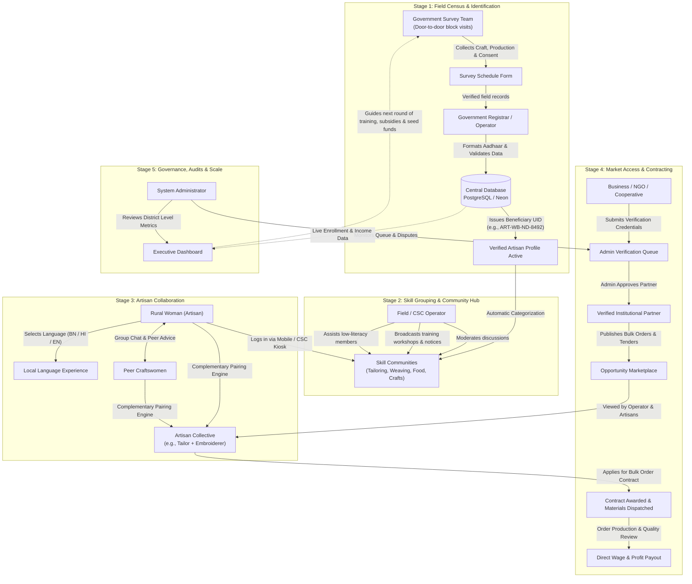
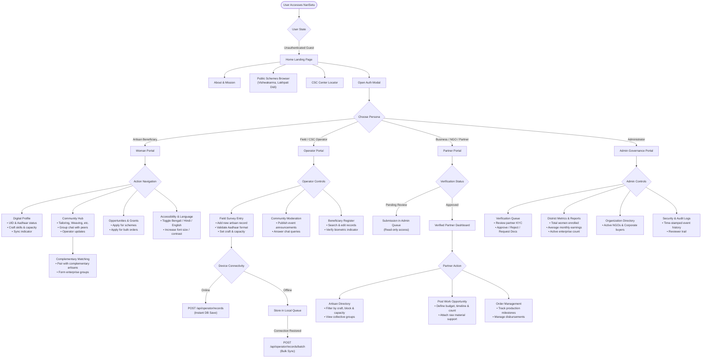
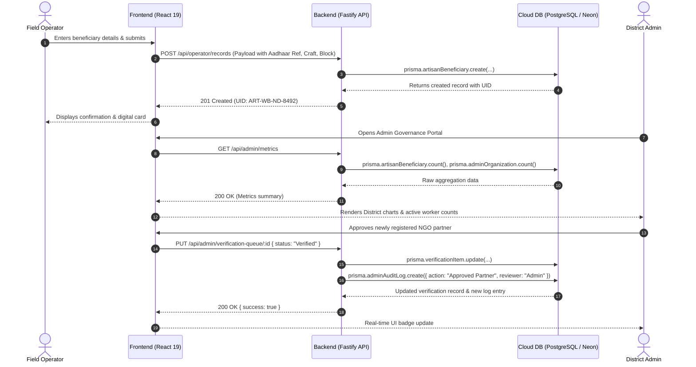

# NariSetu — Stakeholder System Flows & User Architecture Guide

> **Document Purpose**: This guide illustrates and explains how information, data, and workflows navigate across the different **user roles, portals, and system components** within the **NariSetu (Project Trino)** platform.

---

## 📌 Table of Contents

1. [Ecosystem Overview & Stakeholder Mapping](#-ecosystem-overview--stakeholder-mapping)
2. [Master System Flowchart (Cross-Role Lifecycle)](#-master-system-flowchart-cross-role-lifecycle)
3. [User Navigation & State Transition Flowchart](#-user-navigation--state-transition-flowchart)
4. [Detailed Workflow by User Persona](#-detailed-workflow-by-user-persona)
   - [1. Rural Woman (Artisan Beneficiary)](#1-rural-woman-artisan-beneficiary)
   - [2. Grassroots Operator (CSC / Field Enumerator)](#2-grassroots-operator-csc--field-enumerator)
   - [3. Business, NGO & Institutional Partner](#3-business-ngo--institutional-partner)
   - [4. Government Survey Team & Registrar](#4-government-survey-team--registrar)
   - [5. Platform Administrator & District Official](#5-platform-administrator--district-official)
5. [Complementary Skill Pairing Engine (How It Works)](#-complementary-skill-pairing-engine-how-it-works)
6. [Data Flow & API Interaction Sequence](#-data-flow--api-interaction-sequence)
7. [Real-World Village Scenario Walkthrough](#-real-world-village-scenario-walkthrough)

---

## 🌐 Ecosystem Overview & Stakeholder Mapping

NariSetu connects **five distinct user groups** to transform fragmented rural craft capabilities into formal, sustainable micro-enterprises:

```
┌────────────────────────────────────────────────────────────────────────┐
│                        NARISETU UNIFIED PLATFORM                       │
└───────────────────────────────────┬────────────────────────────────────┘
                                    │
    ┌─────────────────┬─────────────┴─────┬────────────────┬─────────────┐
    ▼                 ▼                   ▼                ▼             ▼
┌────────┐    ┌───────────────┐     ┌───────────┐     ┌─────────┐   ┌─────────┐
│ Rural  │    │ Field / CSC   │     │ Business  │     │ Govt    │   │ System  │
│ Woman  │    │ Operator      │     │ & NGOs    │     │ Survey  │   │ Admin   │
└────────┘    └───────────────┘     └───────────┘     └─────────┘   └─────────┘
```

---

## 🔄 Master System Flowchart (Cross-Role Lifecycle)

The following flowchart demonstrates how field inputs from government teams transform into verified digital profiles, which are then mobilized by operators and matched with institutional demand:



---

## 🧭 User Navigation & State Transition Flowchart

This chart outlines the screen transitions and decision points experienced by each user persona when navigating the system:



---

## 👤 Detailed Workflow by User Persona

### 1. Rural Woman (Artisan Beneficiary)
- **Primary Goal**: Showcase craft capabilities, find cooperative peers, access government welfare schemes, and earn dignified household income.
- **Access Channels**: Personal smartphone or village CSC operator kiosk.
- **Workflow Steps**:
  1. **Authentication / Identity Verification**: Enters with phone number or registered UID issued during the block survey.
  2. **Language & Interface Customization**: Chooses preferred language (**Bengali**, **Hindi**, or **English**) and scales font sizes for easy readability.
  3. **Profile Exploration**: Checks official verification badge, enrolled crafts, and recorded production capacities.
  4. **Community Participation**: Enters her designated craft channel (e.g., *Tailoring and Embroidery*). Participates in group discussions, reviews workshop announcements, and tracks upcoming exhibitions.
  5. **Collaborative Grouping**: Uses the *Complementary Pairing Suggestion* card to partner with women who possess complementary skills (e.g., matching a block-printing specialist with a tailor).
  6. **Opportunity Application**: Explores government subsidy schemes (PM Vishwakarma toolkits, Lakhpati Didi loans) or commercial bulk orders and submits an assisted application.

---

### 2. Grassroots Operator (CSC / Field Enumerator)
- **Primary Goal**: Act as the trusted digital bridge for rural women who lack personal smartphones or digital literacy.
- **Access Channels**: Laptop / tablet at the local Common Service Centre (CSC) or field survey device.
- **Workflow Steps**:
  1. **Field Census & Record Creation**: Visits rural households or SHG cluster meetings. Enters artisan demographics, craft specializations, marital status, income levels, and phone numbers via the `Add Artisan Record` form.
  2. **Format Verification**: Validates Aadhaar format reference and captures production capacities.
  3. **Offline Caching & Batch Sync**: If field surveying in low-connectivity areas, saves records locally. Once connected to 4G/Wi-Fi, triggers the batch sync endpoint (`/api/operator/records/batch`) to push records to the cloud database.
  4. **Community Moderation**: Posts local training camps, scheme deadlines, and inbound commercial buyer inquiries to the community message boards.
  5. **Direct Assistance**: Assists beneficiaries with order fulfillment tracking, status checks, and dispute resolution.

---

### 3. Business, NGO & Institutional Partner
- **Primary Goal**: Ethically source verified handmade crafts, textiles, and processed goods directly from rural women collectives at scale.
- **Access Channels**: Web browser on desktop/laptop.
- **Workflow Steps**:
  1. **Onboarding & KYC**: Registers corporate profile (NGO, producer cooperative, exporter, retail brand) and uploads organizational credentials.
  2. **Government Clearance**: Record enters the administrative verification queue (`VerificationItem`). Once vetted by district administrators, full marketplace features unlock.
  3. **Talent Discovery**: Searches the verified artisan database using multi-parameter filters:
     - *District / Block* (e.g., Nadia / Hanskhali)
     - *Craft Domain* (e.g., Jute Craft, Zari Embroidery, Terracotta)
     - *Monthly Production Capacity* (e.g., 200–500 units)
  4. **Publishing Opportunities**: Posts work requirements detailing project specifications, piece-rate budgets, material provisions, and delivery deadlines.
  5. **Contracting & Payment**: Awards contracts to individual artisans or complementary collectives and provides production milestones.

---

### 4. Government Survey Team & Registrar
- **Primary Goal**: Create an accurate, non-duplicative, and tamper-resistant census of rural craft labor to inform state industrial and welfare planning.
- **Access Channels**: Official administrative portal.
- **Workflow Steps**:
  1. **Block-Wise Planning**: Maps target Gram Panchayats and schedules enumerator rounds.
  2. **Informed Consent**: Ensures each beneficiary understands how her data is stored, utilized, and shared for commercial orders.
  3. **Record Validation**: Cross-checks demographic records against block administrative registries to eliminate ghost beneficiaries.
  4. **Issuance of Official UID**: Approves records to generate official identification tokens stored in the central `ArtisanBeneficiary` table.

---

### 5. Platform Administrator & District Official
- **Primary Goal**: Maintain system safety, verify participating organizations, prevent fraudulent exploitation, and analyze district-level macroeconomic outcomes.
- **Access Channels**: Secure admin dashboard (`/api/admin`).
- **Workflow Steps**:
  1. **Verification Queue Management**: Evaluates pending NGO and business applications. Reviews auditor notes, representative contact details, and assigns reviewer decisions (`Verified`, `Awaiting Review`, `Action Needed`).
  2. **Operator & Community Governance**: Creates new skill communities (e.g., introducing *Bamboo & Cane Craft*), assigns certified operators to specific village blocks, and manages operator privileges.
  3. **Audit Trail Inspection**: Reviews the immutable chronological audit log (`AdminAuditLog`) detailing logins, approvals, data modifications, and privilege escalations.
  4. **Strategic Planning & Reporting**: Generates block-wise performance reports. Evaluates how many women transitioned from unorganized labor into active micro-enterprise collectives, directing government credit linkages and capital equipment grants accordingly.

---

## 🧩 Complementary Skill Pairing Engine (How It Works)

A core innovation in NariSetu is moving beyond single-artisan isolation by systematically grouping complementary competencies:

```
┌─────────────────────────────────────────────────────────────────────────────┐
│                 COMPLEMENTARY SKILL PAIRING MECHANISM                       │
├─────────────────────────────────────────────────────────────────────────────┤
│                                                                             │
│  [ Artisan A: Tailoring & Stitching ]  <───┐                                │
│  • Cutting patterns                        │                                │
│  • Garment assembly                        ├───> [ Combined Collective:     │
│  • Size grading                            │       Finished Apparel Unit ]  │
│                                            │       • Can take 500-unit      │
│  [ Artisan B: Kantha / Zari Embroidery ]   │         school uniform order   │
│  • Hand needlework & motifs                │       • Higher market value    │
│  • Border finishing                        ├───>   • Direct corporate sales │
│  • Custom artisan detailing            <───┘                                │
│                                                                             │
│─────────────────────────────────────────────────────────────────────────────│
│                                                                             │
│  [ Artisan C: Clay Potter / Modeler ]  <───┐                                │
│  • Wheel throwing                          ├───> [ Combined Collective:     │
│  • Kiln firing                             │       Decorative Terracotta ]  │
│                                            │       • High-margin gift sets  │
│  [ Artisan D: Folk Painter & Glazer ]  <───┘                                │
│  • Traditional pigment painting                                             │
│                                                                             │
└─────────────────────────────────────────────────────────────────────────────┘
```

1. **Craft Tag Indexing**: During registration, primary crafts and specializations are indexed.
2. **Complementary Affinity Rules**: The system pairs complementary craft tags:
   - `Tailoring` + `Embroidery` ➔ Finished Designer Garments
   - `Weaving` + `Natural Dyeing` ➔ Handloom Textile Value Addition
   - `Clay Pottery` + `Folk Painting` ➔ Premium Terracotta Decor
   - `Fruit/Spice Farming` + `Food Processing` ➔ Packaged Organic Goods
3. **Collaborative Response**: When an enterprise lists a complex order, the operator or system suggests forming a micro-collective so rural women can collectively fulfill volume requirements.

---

## 📡 Data Flow & API Interaction Sequence

The sequence diagram below shows how a frontend client interacts with the backend services when a record is submitted and subsequently approved:



---

## 🌾 Real-World Village Scenario Walkthrough

To understand how NariSetu functions on the ground, consider this concrete scenario in **Hanskhali Block, Nadia District, West Bengal**:

```
                                  VILLAGE CASE STUDY
                      Hanskhali Block, Nadia District, West Bengal
                      ───────────────────────────────────────────

   1. THE SURVEY
      Smt. Rekha Mondal (CSC Field Operator OP-8492) conducts an SHG survey in
      Govindapur village. She registers:
      • Amina Bibi (Age 32): Highly proficient in garment stitching and pattern cutting.
      • Shampa Das (Age 29): Master of traditional Kantha needlework and embroidery.
      Both profiles are verified, Aadhaar-formatted, and assigned to the Hanskhali
      Artisan Register in PostgreSQL.

   2. COMMUNITY ENROLLMENT
      Both women are added to the "Tailoring and Embroidery Community" managed by Rekha.
      Because neither owns a high-end smartphone, Rekha prints their digital profile
      cards and assists them at the Panchayat digital kiosk.

   3. COMPLEMENTARY LINKAGE
      Rekha notices a bulk tender posted by "Nadia Shiksha Sahayata Samity" (a verified NGO):
      "Required: 400 sets of embroidered school uniform pinafores within 45 days."
      Neither Amina (who cannot do intricate embroidery at speed) nor Shampa (who does not
      own a heavy-duty stitching machine) could take this order alone.
      The NariSetu platform suggests a complementary pairing. Rekha convenes both women
      at the CSC center, and they apply jointly as a two-person micro-collective.

   4. CONTRACT & EXECUTION
      The NGO approves the joint bid. The contract terms, unit rate (₹350/unit), and material
      dispatch dates are logged in NariSetu. Amina cuts and stitches the uniforms, then passes
      them to Shampa for Kantha chest embroidery and border motifs.

   5. DELIVERY & IMPACT
      • 400 uniform sets delivered on schedule.
      • Net earnings of ₹1,40,000 distributed directly into the women's bank accounts.
      • The transaction is logged in the system. District Administrator A. Sen reviews the
        block report, noting that Hanskhali Block has met 112% of its micro-enterprise target.
      • The state department allocates ₹50,000 in seed machinery subsidies to upgrade Amina's
        sewing motors and provide Shampa with high-grade silk embroidery thread.
```

---

*This document is part of the **Trino / NariSetu** repository. For full installation, code structure, and development commands, see the root [README.md](./README.md).*
